<p align="center">
  
</p>

<h1 align="center">Shipwright</h1>

<p align="center">
  <strong>The Autonomous Delivery Platform</strong><br>
  From labeled GitHub issue to merged PR — with specialized autonomous agents orchestrating every step.
</p>

<p align="center">
  <a href="https://github.com/sethdford/shipwright/actions/workflows/test.yml"></a>
  <a href="https://github.com/sethdford/shipwright/actions/workflows/shipwright-pipeline.yml"></a>
  
  
  
  
</p>

---

## Table of Contents

- [Shipwright Builds Itself](#shipwright-builds-itself)
- [Code Factory Pattern](#code-factory-pattern)
- [What's New in v4.0.0](#whats-new-in-v400)
- [Upgrading to 4.0](docs/UPGRADING.md)
- [How It Works](#how-it-works)
- [Install](#install)
- [Quick Start](#quick-start)
- [Features](#features)
- [Commands](#commands)
- [Pipeline Templates for Teams](#pipeline-templates-for-teams)
- [Configuration](#configuration)
- [Prerequisites](#prerequisites)
- [Architecture](#architecture)
- [Contributing](#contributing)
- [License](#license)

---

## Shipwright Builds Itself

This repo uses Shipwright to process its own issues. Label a GitHub issue with `shipwright` and the autonomous pipeline takes over: semantic triage, plan, design, build, test, review, quality gates, PR. No human in the loop.

**[See it live](https://github.com/sethdford/shipwright/actions/workflows/shipwright-pipeline.yml)** | **[Create an issue](https://github.com/sethdford/shipwright/issues/new?template=shipwright-build.yml)** and watch it build.

---

## Code Factory Pattern

Shipwright implements the complete **Code Factory** control-plane pattern — where agents write 100% of the code and the repo enforces deterministic, risk-aware checks before every merge. Every decision is traceable to policy. Every merge is backed by machine-verifiable evidence.

```
Agent writes code → Risk policy gate → Tier-appropriate CI → Code review agent
→ Findings auto-remediated → SHA-validated evidence → Bot threads cleaned → Merge
→ Incidents feed back into harness coverage
```

### What makes Shipwright best-in-class

| Code Factory Layer     | Shipwright Implementation                                                                               |
| ---------------------- | ------------------------------------------------------------------------------------------------------- |
| **Single contract**    | `config/policy.json` — risk tiers, merge policy, docs drift, evidence specs, harness SLAs in one file   |
| **Preflight gate**     | `risk-policy-gate.yml` classifies risk from changed files before expensive CI runs                      |
| **SHA discipline**     | All checks, reviews, and approvals validated against current PR head — stale evidence is never trusted  |
| **Rerun writer**       | `sw-review-rerun.sh` — SHA-deduped, single canonical writer, no duplicate bot comments                  |
| **Remediation loop**   | `review-remediation.yml` — agent reads findings and patches code; the workflow validates and pushes the fix |
| **Bot thread cleanup** | `auto-resolve-threads.yml` — resolves bot-only threads after clean rerun, never touches human threads   |
| **Evidence framework** | `sw-evidence.sh` — browser, API, database, CLI, webhook, and custom evidence with freshness enforcement |
| **Harness-gap loop**   | `shipwright incident gap` — every regression creates a test case with SLA tracking                      |

### Beyond the baseline

Shipwright extends the Code Factory pattern with capabilities most implementations don't have:

- **15-stage pipeline** with self-healing builds, adversarial review, and compound quality gates
- **Predictive risk scoring** using GitHub signals (security alerts, contributor expertise, file churn)
- **Persistent memory** — failure patterns, fix effectiveness, and prediction accuracy compound over time
- **Auto-learning** — self-optimize runs automatically after every pipeline completion, including context efficiency tuning
- **Decision engine** — tiered autonomous decisions with outcome learning and deduplication
- **Unified model routing** — `config/models.json` aliases (`opus`, `sonnet`, `haiku`) are the single source of truth for model selection
- **Evidence-gated merges** — SHA discipline ensures all evidence validated against current PR head
- **Semantic quality audits** — Claude-powered audits with grep fallback when Claude unavailable
- **Specialized agent roles** (PM, reviewer, security auditor, test generator, etc.)
- **Cross-platform compatibility** — portable date helpers, file_mtime, and compat layer for macOS/Linux
- **Fleet operations** — the Code Factory pattern applied across every repo in your org
- **Cost intelligence** — per-pipeline cost tracking and budget enforcement
- **Self-optimization** — DORA metrics analysis auto-tunes daemon config and template weights

```bash
# Evidence framework — capture and verify all types
npm run harness:evidence:capture          # All collectors (browser, API, DB, CLI)
npm run harness:evidence:capture:api      # API endpoints only
npm run harness:evidence:capture:cli      # CLI commands only
npm run harness:evidence:capture:database # Database checks only
npm run harness:evidence:verify           # Verify manifest + freshness
npm run harness:evidence:pre-pr           # Capture + verify in one step

# Incident-to-harness loop
shipwright incident gap list
shipwright incident gap sla
```

**[Full Code Factory documentation](https://sethdford.github.io/shipwright/guides/code-factory/)**

---

## What's New in v4.0.0

v4.0.0 hardens how agents, the dashboard and CI are trusted, and starts the move from bash to TypeScript on Bun. **It changes several defaults. Read [docs/UPGRADING.md](docs/UPGRADING.md) before you upgrade.**

- **Least-privilege agents** — agents run under a permission policy (`config/agent-permissions.json`) inside the Claude Code sandbox, and never receive GitHub credentials
- **Dispatch safety gates** — a global circuit breaker, a `shipwright:pause` label, and `shipwright gates check`, `breaker`, `budget`, `intake`, `pause`/`resume`
- **Failure classifier** — `shipwright failure classify` decides retry or escalate; escalations come only from structured error lines
- **Model aliases** — `opus`, `sonnet`, `haiku` in `config/models.json`, mapped to the Claude 5.5 family
- **Differential test gate** — the build loop blocks only on new test failures
- **Dashboard on loopback by default** — use `--host 0.0.0.0` or `SW_DASHBOARD_HOST` for server or fleet mode
- **Bun toolchain** — `bun.lock` is the only root lockfile; Bun 1.2.19+ is required

Full list: [CHANGELOG.md](CHANGELOG.md).

**v3.3.0**: Code Factory pattern — risk policy gate, SHA discipline, evidence framework, review remediation, harness-gap loop

---

## How It Works

```mermaid
graph LR
    A[GitHub Issue] -->|labeled 'shipwright'| B[Daemon]
    B --> C[Triage & Score]
    C --> D[Select Template]
    D --> E[Pipeline]

    subgraph Pipeline ["15-Stage Pipeline"]
        direction LR
        E1[intake] --> E2[spec] --> E3[plan] --> E4[design] --> E5[build]
        E5 --> E6[test] --> E7[review] --> E8[spec verify] --> E9[quality]
        E9 --> E10[audit] --> E11[PR] --> E12[merge] --> E13[deploy]
        E13 --> E14[validate] --> E15[monitor]
    end

    E --> E1
    E15 --> F[Merged PR]

    subgraph Intelligence ["Intelligence Layer"]
        I1[Predictive Risk]
        I2[Model Routing]
        I3[Adversarial Review]
        I4[Self-Optimization]
    end

    Intelligence -.->|enriches| Pipeline

    style A fill:#00d4ff,color:#000
    style F fill:#4ade80,color:#000
```



When tests fail, the pipeline re-enters the build loop with error context — self-healing like a developer reading failures and fixing them. Convergence detection stops infinite loops. A failure classifier decides whether a failed run is retried or escalated.

---

## Install

**One-command install** (recommended):

```bash
git clone https://github.com/sethdford/shipwright.git && cd shipwright && ./install.sh
```

<details>
<summary>Other methods</summary>

**curl**

```bash
curl -fsSL https://raw.githubusercontent.com/sethdford/shipwright/main/scripts/install-remote.sh | bash
```

**npm** (global)

```bash
npm install -g shipwright-cli
```

Shipwright 4.0 needs [Bun](https://bun.sh) 1.2.19+ for the dashboard and the TypeScript commands. Upgrading from 3.x? See [docs/UPGRADING.md](docs/UPGRADING.md).

**Verify**

```bash
shipwright doctor
```

</details>

## Quick Start

```bash
# One-command setup
shipwright init

# See what's running
shipwright status

# Process a GitHub issue end-to-end
shipwright pipeline start --issue 42

# Run daemon 24/7 with agent orchestration
shipwright daemon start --detach

# See live agent activity
shipwright activity

# Spin up agent team for manual work
shipwright session my-feature -t feature-dev

# View DORA metrics and pipeline vitals
shipwright dora

# Continuous build loop with test validation
shipwright loop "Build auth module" --test-cmd "npm test"

# Multi-repo operations
shipwright fleet start
shipwright fix "upgrade deps" --repos ~/a,~/b,~/c

# Release automation
shipwright version bump 4.1.0
shipwright changelog generate
```

---

## Features

### Specialized Agents

Wave 1 (Organizational):

- **Swarm Manager** — Orchestrates dynamic agent teams with specialization roles
- **Autonomous PM** — Team leadership, task scheduling, roadmap execution
- **Knowledge Guild** — Cross-team learning, pattern capture, mentorship
- **Recruitment System** — Talent acquisition and team composition
- **Standup Automaton** — Daily standups, progress tracking, blocker detection

Wave 2 (Operational Backbone):

- **Quality Oversight** — Intelligent audits, zero-defect gates, completeness verification
- **Strategic Agent** — Long-term planning, goal decomposition, roadmap intelligence
- **Code Reviewer** — Architecture analysis, clean code standards, best practices
- **Security Auditor** — Vulnerability detection, threat modeling, compliance
- **Test Generator** — Coverage analysis, scenario discovery, regression prevention
- **Incident Commander** — Autonomous triage, root cause analysis, resolution
- **Dependency Manager** — Semantic versioning, update orchestration, compatibility checking
- **Release Manager** — Release planning, changelog generation, deployment orchestration
- **Adaptive Tuner** — DORA metrics analysis, self-optimization, performance tuning
- **Strategic Intelligence** — Predictive analysis, trend detection, proactive recommendations

### 15-Stage Delivery Pipeline

```
intake → spec_generation → plan → design → build → test → review → spec_verification
→ compound_quality → audit → pr → merge → deploy → validate → monitor
```

Each stage is configurable with quality gates that auto-proceed or pause for approval. 9 pipeline templates:

| Template     | Stages                                                    | Use Case                  |
| ------------ | --------------------------------------------------------- | ------------------------- |
| `fast`       | intake → spec → build → test → quality → PR               | Quick fixes               |
| `hotfix`     | Same as fast, all auto, minimal iteration                 | Urgent production fixes   |
| `standard`   | + plan, design, review, spec verification, merge          | Normal feature work       |
| `tdd`        | Like standard, tests generated before build               | Test-first work           |
| `full`       | All 15 stages                                             | Production deployment     |
| `autonomous` | Through audit, PR, merge, monitor; all auto               | Daemon-driven delivery    |
| `enterprise` | Through deploy, validate, monitor; all gates on approve   | Maximum safety + rollback |
| `cost-aware` | Through audit and PR, with budget limits                  | Budget-limited delivery   |
| `deployed`   | Through merge, deploy, validate, monitor                  | Full deploy pipeline      |

### Intelligence Layer

7 modules that make the pipeline smarter over time. Intelligence defaults to `auto` (on when the Claude CLI is available) once `shipwright daemon init` has created `.claude/daemon-config.json`; without that file it is off. Set `intelligence.enabled=false` to disable. All modules degrade gracefully.

| Module                       | What It Does                                                                                                          |
| ---------------------------- | --------------------------------------------------------------------------------------------------------------------- |
| **Semantic Triage**          | AI-powered issue analysis, complexity scoring, template selection                                                     |
| **Pipeline Composer**        | Generates custom pipeline configs from codebase analysis (file churn, test coverage, dependencies)                    |
| **Predictive Risk**          | Scores issues for risk using GitHub signals (security alerts, similar past issues, contributor expertise)             |
| **Adversarial Review**       | Red-team code review — finds security flaws, edge cases, failure modes. Cross-checks against CodeQL/Dependabot alerts |
| **Self-Optimization**        | Reads DORA metrics and auto-tunes daemon config. Includes context efficiency closed loop for token budget tuning      |
| **Developer Simulation**     | 3-persona review (security, performance, maintainability) before PR creation                                          |
| **Architecture Enforcement** | Living architectural model with violation detection and dependency direction rules                                    |

Adaptive tuning: thresholds learn from history, poll intervals adjust to queue depth, and memory timescales tune based on fix effectiveness. Model routing is deterministic through `config/models.json` aliases; the older learned routing is opt-in with `SW_LEGACY_MODEL_ROUTING=true`.

### GitHub Deep Integration

Native GitHub API integration enriches every intelligence module:

| API                   | Integration                                                                              |
| --------------------- | ---------------------------------------------------------------------------------------- |
| **GraphQL**           | File change frequency, blame data, contributor expertise, similar issues, commit history |
| **Checks API**        | Native check runs per pipeline stage — visible in PR timeline, blocks merges on failure  |
| **Deployments API**   | Tracks deployments per environment (staging/prod), rollback support, deployment history  |
| **Security**          | CodeQL + Dependabot alerts feed into risk scoring and adversarial review                 |
| **Contributors**      | CODEOWNERS-based reviewer routing, top-contributor fallback, auto-approve as last resort |
| **Branch Protection** | Checks required reviews and status checks before attempting auto-merge                   |

### Decision Engine

The autonomous decision engine (`config/policy.json` → `decision` section) handles routine operational decisions with outcome learning. Decisions are tiered by risk, with low-risk actions auto-approved and higher tiers escalated. The engine learns from outcomes to improve future decisions.

### Context Engineering

Intelligent context window management for pipeline agents:

- **Budget-aware trimming** — Configurable character budgets for prompt composition (`context_budget_chars`)
- **Section-level trimming** — Independent limits for memory, git history, hotspot files, and test output
- **Context efficiency metrics** — Tracks budget utilization and trim ratios per iteration
- **Self-tuning** — The self-optimization loop analyzes context efficiency events and recommends budget adjustments

### Autonomous Daemon

```bash
shipwright daemon start --detach
```

Watches GitHub for labeled issues and processes them 24/7:

- **Auto-scaling**: Adjusts worker count based on CPU, memory, budget, and queue depth
- **Priority lanes**: Reserve a worker slot for urgent/hotfix issues
- **Retry with escalation**: a failure classifier decides retry or escalate; retries move to a stronger model first, then to the `full` template
- **Patrol mode**: Proactively scans for security issues, stale deps, dead code, coverage gaps
- **Self-optimization**: Tunes its own config based on DORA metrics over time

### Fleet Operations

```bash
shipwright fleet start
```

Orchestrate daemons across multiple repositories with a shared worker pool. Workers rebalance based on queue depth, issue complexity, and repo priority.

### Persistent Memory

The pipeline learns from every run:

- **Failure patterns**: Captured and injected into future builds so agents don't repeat mistakes
- **Fix effectiveness**: Tracks which fixes actually resolved issues
- **Prediction validation**: Compares predicted risk against actual outcomes, auto-adjusts thresholds
- **False-alarm tracking**: Reduces noise by learning which anomalies are real

### Cost Intelligence

```bash
shipwright cost show
```

Per-pipeline cost tracking with model pricing, budget enforcement, and ROI analysis.

### Real-Time Dashboard

```bash
shipwright dashboard start
```

Web dashboard with live pipeline progress, GitHub context (security alerts, contributors, deployments), DORA metrics, cost tracking, and context efficiency metrics. WebSocket-powered, updates in real-time. Binds `127.0.0.1` by default; use `--host 0.0.0.0` or `SW_DASHBOARD_HOST` for server or fleet mode, after reading [docs/dashboard-exposure.md](docs/dashboard-exposure.md).

### Webhook Receiver

```bash
shipwright webhook setup owner/repo
shipwright webhook start
```

Issue processing via GitHub webhooks instead of polling. `setup` registers the webhook on a repo and `start` runs the receiver.

### PR Lifecycle Automation

```bash
shipwright pr review <pr#>
shipwright pr merge <pr#>
shipwright pr cleanup
```

Automated PR management: review based on predictive risk and coverage, auto-merge when gates pass, and closing stale PRs.

### Fleet Auto-Discovery

```bash
shipwright fleet discover --org myorg
```

Scan a GitHub organization and auto-populate fleet config with all repos matching criteria (language, topic, recent activity; archived repos are skipped). One command instead of manual registry building.

### SQLite Persistence

SQLite-backed state (`shipwright db`) with atomic transactions, alongside the JSON and JSONL artifacts that many scripts still read.

### Issue Decomposition

```bash
shipwright decompose analyze 42
shipwright decompose decompose 42
```

AI-powered issue analysis: `analyze` scores complexity; `decompose` creates child issues with inherited labels/assignees and a dependency graph.

### Linux systemd Support

Cross-platform process supervision. Use systemd on Linux instead of tmux, same daemon commands:

```bash
shipwright launchd install  # macOS launchd
# systemd service auto-generated on Linux
```

### Context Engine

```bash
shipwright context gather
```

Rich context injection for pipeline stages. Pulls together: contributor history, file hotspots, architecture rules, related issues, failure patterns. Injected automatically at each stage for smarter decisions.

---

## Commands

Over 100 commands. Key workflows:

```bash
# Autonomous delivery
shipwright pipeline start --issue 42
shipwright daemon start --detach

# Agent teams
shipwright swarm status
shipwright recruit roles
shipwright standup today
shipwright guild list

# Quality gates
shipwright code-review scan
shipwright security-audit scan
shipwright testgen gaps
shipwright breaker status

# Observability
shipwright vitals
shipwright dora
shipwright stream
shipwright activity

# Multi-repo operations
shipwright fleet start
shipwright fix "feat: add auth" --repos ~/a,~/b,~/c
shipwright fleet-viz

# Release automation
shipwright version bump 4.1.0
shipwright changelog generate
shipwright deploys list

# Setup & maintenance
shipwright init
shipwright prep
shipwright doctor
shipwright upgrade --apply

# See all commands
shipwright --help
```

See [docs/reference/legacy-guide.md](docs/reference/legacy-guide.md) for the complete 100+ command reference organized by workflow. Full documentation: [https://sethdford.github.io/shipwright](https://sethdford.github.io/shipwright).

## Pipeline Templates for Teams

25 team templates covering the full SDLC:

```bash
shipwright templates list
```

## Configuration

| File                          | Purpose                                                                                     |
| ----------------------------- | ------------------------------------------------------------------------------------------- |
| `config/policy.json`          | **Central contract** — risk tiers, merge policy, docs drift, browser evidence, harness SLAs |
| `config/policy.schema.json`   | JSON Schema validation for the policy contract                                              |
| `.claude/daemon-config.json`  | Daemon settings, intelligence flags, patrol config                                          |
| `.claude/pipeline-state.md`   | Current pipeline state                                                                      |
| `templates/pipelines/*.json`  | 9 pipeline template definitions                                                             |
| `tmux/templates/*.json`       | 25 team composition templates                                                               |
| `config/models.json`          | Model aliases (`opus`, `sonnet`, `haiku`) and the default                                   |
| `config/agent-permissions.json` | Least-privilege permission policy every agent runs under                                  |
| `~/.shipwright/events.jsonl`  | Event log for metrics                                                                       |
| `~/.shipwright/costs.json`    | Cost tracking data                                                                          |
| `~/.shipwright/budget.json`   | Budget limits                                                                               |
| `~/.shipwright/github-cache/` | Cached GitHub API responses                                                                 |

## Prerequisites

| Requirement     | Version | Install                                |
| --------------- | ------- | -------------------------------------- |
| tmux            | 3.2+    | `brew install tmux`                    |
| jq              | any     | `brew install jq`                      |
| Claude Code CLI | latest  | `npm i -g @anthropic-ai/claude-code`   |
| Bun             | 1.2.19+ | `curl -fsSL https://bun.sh/install \| bash` (dashboard and TypeScript commands) |
| Node.js         | 20+     | For npm install and hooks              |
| Git             | any     | For installation                       |
| gh CLI          | any     | `brew install gh` (GitHub integration) |

## Architecture

About 200 bash scripts (~117K lines, not counting tests) and a growing TypeScript core on Bun (`src/`). 174 shell test suites, including an E2E system test of the daemon→pipeline→loop→PR flow, plus dashboard and TypeScript test suites. Dashboard coverage is gated at 70% of lines. Bash 3.2 compatible — runs on macOS and Linux.

**Core Layers:**

```
Pipeline Layer
  sw-pipeline.sh              # 15-stage delivery orchestration
  sw-daemon.sh                # Autonomous GitHub issue watcher
  sw-loop.sh                  # Continuous multi-iteration build loop

Agent Layer
  sw-swarm.sh                 # Dynamic agent team orchestration
  sw-pm.sh                    # Autonomous PM coordination
  sw-recruit.sh               # Agent recruitment system
  sw-standup.sh               # Daily team standups
  sw-guild.sh                 # Knowledge guilds
  sw-oversight.sh             # Quality oversight board
  sw-strategic.sh             # Strategic intelligence
  sw-scale.sh                 # Dynamic team scaling
  ... more agent scripts

Intelligence Layer
  sw-intelligence.sh          # AI analysis engine
  sw-predictive.sh            # Risk scoring + anomaly detection
  sw-adaptive.sh              # Data-driven pipeline tuning
  sw-security-audit.sh        # Security analysis
  sw-code-review.sh           # Code quality analysis
  sw-testgen.sh               # Test generation
  sw-architecture-enforcer.sh # Architecture enforcement

Operational Layer
  sw-fleet.sh                 # Multi-repo orchestration
  sw-ci.sh                    # CI/CD orchestration
  sw-webhook.sh               # GitHub webhooks
  sw-incident.sh              # Incident response
  sw-release-manager.sh       # Release automation
  ... 20+ operational scripts

Observability Layer
  sw-pipeline-vitals.sh       # Pipeline health scoring
  sw-dora.sh                  # DORA metrics dashboard
  sw-activity.sh              # Live activity streams
  sw-replay.sh                # Pipeline playback
  sw-trace.sh                 # E2E traceability
  sw-otel.sh                  # OpenTelemetry integration
  ... observability services

Infrastructure
  sw-github-graphql.sh        # GitHub GraphQL API client
  sw-github-checks.sh         # Native GitHub check runs
  sw-github-deploy.sh         # Deployment tracking
  sw-memory.sh                # Persistent learning system
  sw-cost.sh                  # Cost intelligence
  sw-db.sh                    # SQLite persistence
  sw-eventbus.sh              # Async event bus

Tools & UX
  dashboard/server.ts         # Real-time dashboard
  sw-session.sh               # tmux agent sessions
  sw-status.sh                # Team dashboard
  sw-docs.sh                  # Documentation sync
  sw-tmux.sh                  # tmux health management
```

## Contributing

**Let Shipwright build it:** Create an issue using the [Shipwright template](https://github.com/sethdford/shipwright/issues/new?template=shipwright-build.yml) and label it `shipwright`. The autonomous pipeline will triage, plan, build, test, review, and create a PR.

**Manual development:** Fork, branch, then:

```bash
bun run check   # typecheck, lint, architecture rules, TS and dashboard tests, docs
npm test        # 174 shell suites, including the E2E system test
```

## License

MIT — Seth Ford, 2026.
