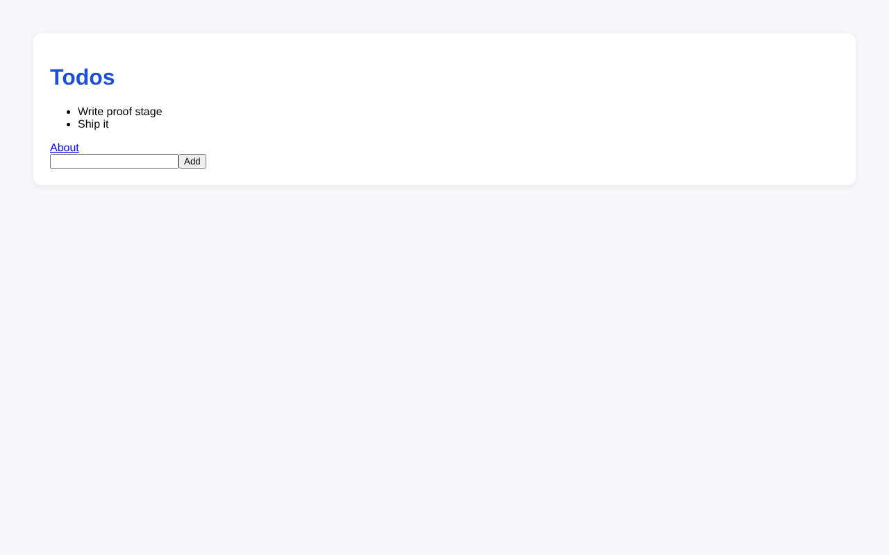
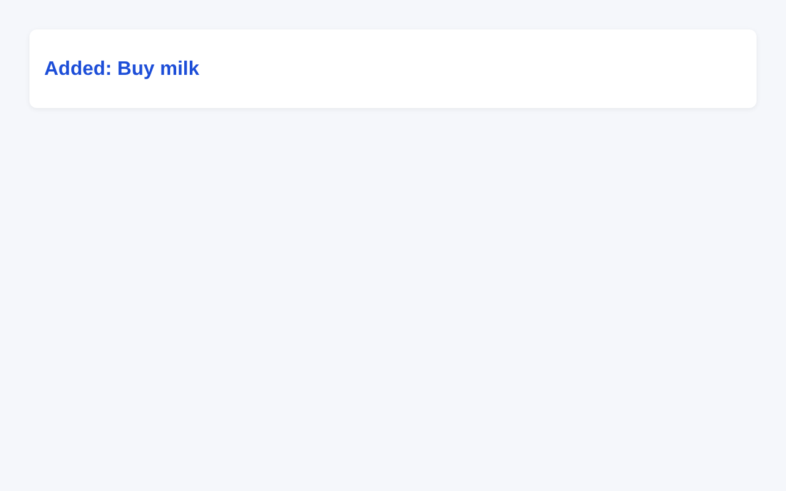

<!-- shipwright:proof -->
### Proof it runs

✅ **The app ran and the changed flows worked.**

#### Web app

Started `node server.js` (.shipwright/proof.json), served at `http://127.0.0.1:39207`. [server log](https://github.com/sethdford/shipwright/raw/633b40eb9531f85d3d06d926d0039b31e79d865d/demo-todo-app/0d743fe03ac1/web/server.log).

**✅ home**


- [video of this flow](https://github.com/sethdford/shipwright/raw/633b40eb9531f85d3d06d926d0039b31e79d865d/demo-todo-app/0d743fe03ac1/web/1-flow.webm)
- blocked 1 request(s) to outside hosts

**✅ add item**


- [video of this flow](https://github.com/sethdford/shipwright/raw/633b40eb9531f85d3d06d926d0039b31e79d865d/demo-todo-app/0d743fe03ac1/web/2-flow.webm)
- blocked 2 request(s) to outside hosts

#### Command line

**✅ `node bin/todo.js --help`** (exit 0)

<details><summary>output</summary>

```text
$ node bin/todo.js --help
usage: todo [add ITEM] [list]

A tiny todo CLI.

[exit 0]
```

</details>

_Run in the sandbox without credentials; requests to outside hosts were blocked._