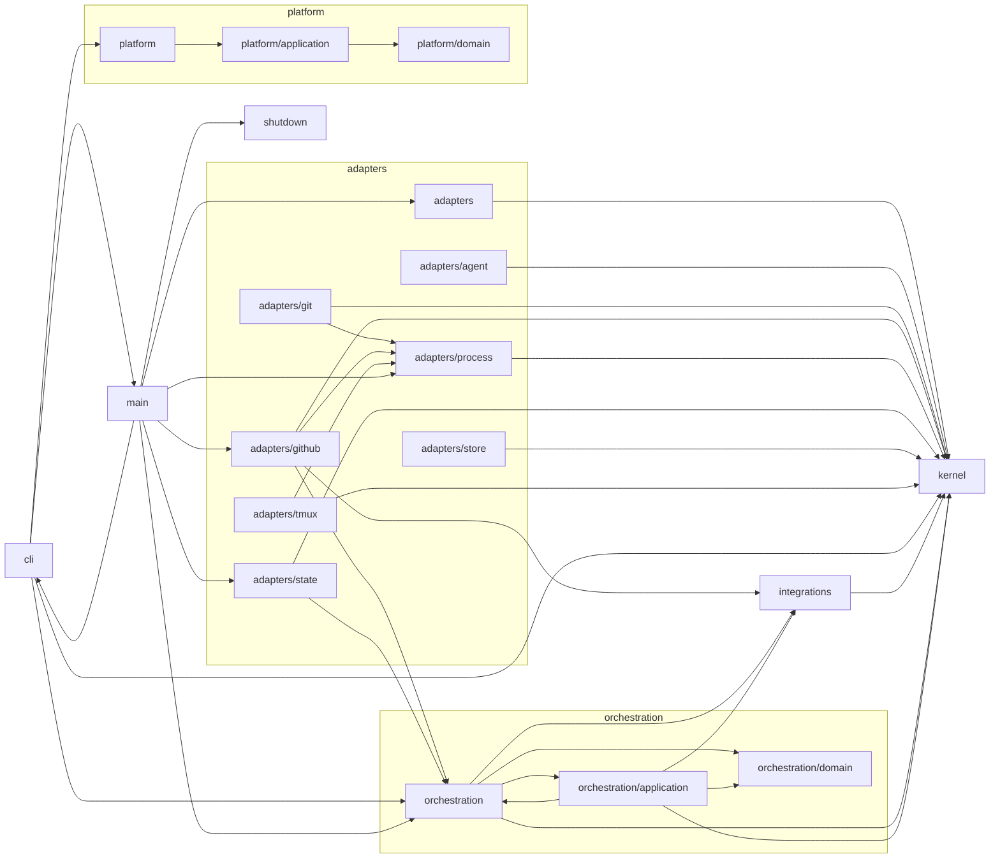

# Dependency graph

<!-- Generated by tools/docs/gen-dependency-graph.ts. Do not edit. -->

Imports between the layers of `src/` (tests and `src/testing` excluded), collapsed to contexts,
their `domain`/`application` layers, adapters, the kernel and the entry points. Rules: [architecture](../architecture.md#fitness-rules).

